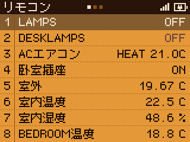

# Home Control

A Home Assistant remote for the **M5Stack Core Basic v2.7** (ESP32, 320x240).



- M5Code-style menu: eight rows per page
- Two themes: `Flipper` (default) and `Classic`
- Bitmap font for menu rows, states, and detail values
- Font trial: BoutiqueBitmap9x9 Regular, with each native dot doubled exactly
  (typical CJK ink 18×18 px); see [font details](assets/fonts/README.md)
- Numbered index column, entity name, live state on the right
- Dynamic number of pages, eight entities per page
- Configurable page titles, default `PAGE1`, `PAGE2`, ...
- Live state over the Home Assistant WebSocket API
- Control over the Home Assistant REST API
- Configuration stored in NVS
- Web configuration with an entity selector loaded from Home Assistant
- Normal/dim/off display states with day/night schedules and web previews
- M5Code arrow/select sound effects through the built-in speaker
- Value-area refreshes leave unchanged labels and rows untouched
- No boot/setup screen: the menu is shown immediately

## Layout

```
+--------------------------------------+
| PAGE1        ####          )) []      |  status bar 24 px
+--------------------------------------+
| 1 | Living room light      ON 80%     |
| 2 | Desk lamp              OFF        |
| 3 | Air conditioner        COOL 24.0C |
| 4 | TV                     PLAYING    |
| 5 | Movie night            SCENE      |
| 6 | Indoor temperature     23.4C      |
| 7 |                                   |
| 8 |                                   |
+--------------------------------------+
```

- Menu starts at y = 24
- Row height = 27 px, eight rows per page
- Left index column: 24 px
- Index digits are centered by their visible pixels, above the row divider
- Font cell starts 2 px below the row top; typical Latin ink starts at 6 px
- Flipper theme: orange rows, dark index text; the selected row and index cell
  use a medium brown background with cream text
- Classic theme: dark blue selected row with green text
- Row divider: 1 px solid line in Classic, dotted in Flipper
- No bottom hint bar
- Entity state is right-aligned at x = 314
- Temperature units use `C` / `F` without the degree circle, including sensor
  and AC AUX values
- Custom display name overrides the Home Assistant friendly name; empty uses the
  HA friendly name
- Climate entities show the actual HA mode: `HEAT`, `COOL`, `AUTO`, `DRY`,
  `FAN`, `OFF`, plus the target temperature. If no target is available, the menu
  falls back to the measured temperature; AC detail's CURRENT row shows the
  measured room temperature

## Status bar

- Left: current page title
- Center: page squares, active page highlighted
- Right: combined Wi-Fi / HA link icon, then the battery icon
- Wi-Fi is not configured: dim signal icon, blinking
- While connecting, retrying, or disconnected: the signal icon blinks; no red X
- Confirmed Core USB charging: bolt inside the battery icon
- Assumed dock/external power: plug overlay; charging/full status remains unknown
- Unavailable battery reading: `?` until the dock hint activates
- No clock, no battery percentage
- The battery icon is monochrome, same color as the signal bars

## Dynamic pages and titles

Pages are explicitly configured in the web UI. Use **Add page** and
**Remove page** in the backend; the device shows exactly the configured number
of pages, including empty pages.

- Eight slots per page
- Maximum 12 pages / 96 slots
- Page title defaults to `PAGEn` (no space)
- Empty slots stay in place; pages are not compacted
- Page 1 can have three entities and five empty slots; page 2 stays independent

Page switching:

- Grid **r1c2 (M)** / **r1c3 (%)** while the menu is visible; wraps at either end
- Serial `p` / `n`

The Core's **A/C** buttons move the cursor within the current page.

## Battery and power

The Faces Bottom3 side LEDs briefly sweep from bottom to top on both sides when
the device sends a Home Assistant service command. The sweep uses the active
theme's `commandLedColor` (Flipper orange / Classic green), follows current screen
brightness including the day/night schedule, and turns off after 300 ms.
It runs independently of HTTP, so slow HA responses do not freeze it. A new
command restarts the sweep. Polling and incoming state updates do not trigger it.

The automatic battery-level bar and web LED test controls remain removed.
A black frame clears any latched LED color at startup. `/diag` reports command
animation readiness, brightness (0-255), duration, theme color, active state,
trigger count, and the last sweep's frame count and visited-pixel mask
(`1023` means all ten pixels).

The on-screen battery icon remains. On Core Basic, three consecutive unavailable
PMIC samples show a plug over the battery: assumed dock/external power, with
charging status unknown. A responding PMIC clears this hint immediately.
This user-selected heuristic can also trigger on an I2C fault. Before it activates,
an unavailable battery reading shows `?`, never an empty battery.
Power is sampled every 500 ms, so the hint takes roughly 1–1.5 seconds to activate.

The Bottom3 has its own TP4057 charger and a separate battery power switch.
The Core's IP5306 readings do not directly report the TP4057 charging state.
The four dock contacts are **J3**, wired as GND, SYS_5V, GPIO21/SDA, and
GPIO22/SCL. **J4 is the separate battery connector**, not the dock pinout.
Dock SYS_5V feeds the TP4057 charger and, through isolation diode D1, BUS_5V
for the running device. The TP4057 charges BAT; with the battery switch on,
BAT_ON feeds the Core's battery connection. Off the dock, the Core's IP5306
boosts that battery supply to the system 5V rail. The dock therefore bypasses
the IP5306's USB input; it does not physically disconnect the IP5306.
The keypad shares M5Unified's I2C driver with the PMIC. `/diag` includes the bus
pins and IP5306 registers `00`, `01`, `70`, `71`, and `78` for power troubleshooting.
It also reports the current page and focus. It does not read the ESP32 Hall
sensor: `hallRead()` changes GPIO39 (Button A) into analog mode and can cause a
phantom button press.

Espressif withdrew the built-in Hall sensor as a supported feature because it
does not work properly; see
[PCN20221202](https://documentation.espressif.com/PCN20221202%20Remove%20Hall%20Sensor%20from%20ESP32%20Series%20of%20Documentation.pdf).
The firmware contains no Hall-sensor sampling or experimental Hall endpoint.

The firmware retries an unavailable PMIC, including after startup on the dock.
After three failed samples it reinitializes the shared I2C bus and retries the
PMIC, at most once per ten seconds. When the IP5306 responds, its boost keep-on
bit is enabled to keep the battery output ready while dock power bypasses it.
The manager also verifies boost enable, Core charge enable, and automatic boost
handoff when the Core input is removed. Register changes use read-modify-write;
charger voltage/current, low-battery cutoff, and reserved bits are preserved.
A PMIC already asleep and not
responding to I2C may still need a single press of the red power button or USB
power to wake it.

Docked telemetry may still become unavailable even with boost keep-on enabled.
In the device test, battery handoff continued working and live readings returned
after undocking. A plug means assumed dock power, not confirmed charging/full;
`?` means no current battery reading and does not mean empty.

Web -> Display -> **Refresh battery status**, or `GET /power`, reports the
battery percentage, battery voltage, USB-input voltage, and Core USB charger.
Voltage fields show `Unavailable` when the hardware does not expose a reading.
In particular, the Core Basic's IP5306 has no readable battery/VBUS voltage;
a percentage reading is not converted into a made-up voltage.
`/diag` uses `charging=unknown` when there is no confirmed charging/full signal;
an inactive Core charger is not proof that the dock is not charging.
It also reports `dock_inferred`, `pmic_online`, `core_keep_on`, `core_boost_enabled`,
`core_charge_enabled`, `core_battery_handoff`, and `power_recoveries`.
The Bottom3 TP4057's `CHRG` and `STDBY` pins are unconnected in the
[manufacturer schematic](https://m5stack-doc.oss-cn-shenzhen.aliyuncs.com/1273/A168_Faces_Bottom3_Sche.pdf),
so actual dock charging detection requires a hardware status connection.

## Backlight schedule

Configured in the web page under **Display**. Schedule times use Home Assistant's
configured timezone. A watched HA `now()` template supplies UTC time, the current
UTC offset, and the timezone name over the authenticated WebSocket connection.
Updates arrive on connection and at each minute boundary, so HA handles daylight
saving and timezone changes. No fixed UTC+8 timezone or public NTP server is used.
The web Display section shows HA local time and timezone when the page is loaded.

- `day`: 07:00-21:00, brightness 5%, automatic dim/off disabled by default
- `night`: 21:00-07:00, brightness 5%; after 10 minutes idle, dim at 1% for
  2 more minutes, then turn off (12 minutes total)
- Each period has normal/dim brightness, an idle-to-dim timeout, and a
  dim-to-off timeout. The web form uses seconds: night defaults are 600 and 120
- Dim mode uses a black background, faint grey text, and subdued selection,
  numbers, status icons, and editing colors regardless of the chosen normal theme
- `0` disables a timeout. If dimming is disabled, the off timeout starts at last input
- Any device button or serial navigation key restores the normal theme/brightness
  and resets idle time
- From dim, a key restores the normal view and performs its action. From off,
  the first press only wakes the display; the next press performs its action.
  A held A/B/C wake press stays suppressed until release, including B's long press
- Background updates, schedule changes, and clock recovery cannot wake or
  brighten a dim/off screen
- Web **Wake**, **Dim**, and **Off** buttons preview the live display using saved
  brightness settings without saving. Device input clears the preview; Wake returns
  to the normal view
- Older custom nonzero off timeouts keep their direct-to-off behavior; an old
  disabled night timeout adopts the new 10-minute/2-minute defaults

The fallback brightness is used until the first valid HA clock sample arrives.
Between updates, a 64-bit monotonic clock keeps time advancing. If HA disconnects,
the last known offset is retained until a fresh sample arrives after reconnect;
DST/timezone changes while offline cannot be learned until then. Missing or
invalid clock updates are retried without changing the last good clock.
Once dim/off, clock synchronization cannot brighten the display.

## Sound

Menu movement plays `sfx_arrow`; actions play `sfx_select`. Both are the
original M5Code WAV effects played through the built-in Core speaker via
`M5.Speaker`.
Docking and undocking are silent.

## Home Assistant setup

A **long-lived access token** is required even when the dashboard itself allows
anonymous viewing.

1. Home Assistant -> profile -> Security -> Long-lived access tokens
2. Create a token
3. Open the device web page and paste the token

The base URL is pre-filled with `http://10.0.0.11:8123`.

### Entity selector

When a token is configured and Wi-Fi is up, the web page downloads
`/api/states` and fills a shared `<datalist>`. Start typing in an entity field
or open the list. Manual entity IDs still work if the list cannot be loaded.
The entity list is cached for 60 seconds.

## Web configuration

- No saved Wi-Fi SSID: open AP `HA-Remote`, then `http://192.168.4.1`
- Normal operation: `http://<device-ip>/` or `http://ha-remote.local/`
- With saved Wi-Fi credentials, the device keeps retrying a lost connection

Fields:

- Theme: `Flipper` (default) or `Classic`
- Fallback brightness, 1-100%, default 30%
- Day/night normal/dim brightness, dim/off timeouts, and live Wake/Dim/Off previews
- Dynamic page blocks: title + eight slots
- Each slot: entity ID and display name
- Climate slots only: optional AUX entity/name and allowed MODE values (COOL/HEAT/DRY/FAN/AUTO)
- Hostname used for `http://<hostname>.local/`, including web firmware updates
- Wi-Fi SSID and password
- Home Assistant base URL
- Long-lived access token

The page is plain: square inputs and buttons, no rounded corners. Empty slots
and empty pages are kept as configured.
After saving, the page waits for the device to restart and reloads automatically.
If reconnection times out, it reports the problem and enables Save again.
The **Download screenshot** link beside **Update firmware** saves the current
320×240 display as a BMP. It streams one row at a time using about 1 KB of
working memory. Capturing does not wake the display or change pages.

### Web endpoints

| Method and path | Purpose |
| --- | --- |
| `GET /` | Configuration form |
| `POST /save` | Save settings and reboot; the web form reconnects automatically |
| `POST /display` | Preview the display with form field `mode=wake`, `dim`, or `off`; settings are not saved |
| `GET /power` | Current battery and Core charger readings |
| `GET /diag` | Menu, backlight, LED, and power diagnostics; reading it does not wake the display |
| `GET /screenshot.bmp` | Stream the current display as `ha-remote-screen.bmp`; does not redraw or wake the display |
| `GET /update` | Firmware upload form; requires the firmware username/password |
| `POST /update?size=<bytes>` | Authenticated firmware upload using multipart field `firmware` |

Backlight diagnostics include `backlight=normal|dim|off`, `backlight_pwm` (0–255),
`dim_theme` (0/1), and `display_override` (-1 for automatic, 1 for Dim preview,
2 for Off preview). **Wake** and physical input clear the override. Automatic
updates may dim or turn off the screen, but cannot wake or brighten it.
Clock diagnostics include `time_source=ha|unavailable`, `ha_timezone`,
`utc_offset` (seconds east of UTC), `local_time`, and `ha_clock_age` (seconds
since the last valid sample). Reading diagnostics does not count as activity.

## Serial configuration

`115200` baud, commands start with `:`.

```
:wifi <ssid> <password>
:ha <url> [token]
:entity <1-96> <entity_id>
:name <1-96> <display name>
:title <1-12> <name>
:bright <1-100>
:show
:clear
:reboot
:help
```

`:clear` erases the NVS namespace, including Wi-Fi credentials.

## Controls

| Input | Action |
| --- | --- |
| A / C | cursor up / down (wraps within the page, skips empty slots) |
| B short press | toggle the focused entity / cycle AC mode; activate the focused AC detail control |
| B long press | open AC detail from the menu / return to the menu from AC detail |
| 1-8 in the main menu | select and run that slot on the current page |
| FACES keypad 1-7 in AC detail | focus that control; B or r5c4 activates/confirms it |
| FACES keypad r1c1 (AC) | back to main menu; discards an unconfirmed temperature edit |
| FACES keypad r1c2 (M) / r1c3 (%) | previous / next page (wraps at either end; main menu only) |
| FACES keypad 0 | back / cancel temperature edit |
| FACES keypad r5c4 (=), short or long press | open AC detail if available; otherwise toggle/run the focused entity; activate or confirm within AC detail |
| FACES keypad r3c4 (+) / r4c4 (-) | increase / decrease the selected adjustable value |
| Select an AC item | cycle OFF and its allowed, HA-supported modes |

Number positions are remapped on the physical keypad:

```text
       c1   c2   c3   c4
r2      1    2    3
r3      4    5    6    +
r4      7    8    9    -
```

Other keypad positions keep their existing behavior. There are eight menu slots,
so 9 has no assigned slot. Serial digits retain their normal numeric meanings.

In the main menu, `+`/`-` adjusts AC target temperature by HA's reported
`target_temp_step`, clamped to `min_temp`/`max_temp`, or light brightness by 10
percentage points, clamped to 0-100%. At 0%, the light turns off. On/off-only
lights, unavailable entities, sensors, and other non-adjustable items do nothing.
The target/value updates after a successful HA command; no command is sent when
already at the requested limit. Adjusting AC temperature does not optimistically
change its power state.
The AC menu shows the target setpoint, so successful `+`/`-` changes are visible
immediately even while the measured room temperature remains steady.

Only AC items have a detail panel. Sensors remain read-only in the main menu.
These actions apply when the display is normal or dim. When it is off, the
first key press only wakes it, including a held B press; release and press again
to perform an action. Web **Wake** changes only the display state.

## AC detail

Long press B on a `climate.*` row opens a detail menu with eight numbered rows:

```
1  MODE       COOL
2  TEMP       24.0C
3  FAN        AUTO
4  SWING      OFF
5  ACTION     COOLING
6  <AUX name> ON
7  CURRENT    27.5C
8
```

- MODE cycles OFF plus the allowed, HA-supported modes configured in the web UI
- TEMP enters edit mode: A/C change by `target_temp_step`, B confirms; long B discards the edit and returns to the menu
- With TEMP highlighted, `+`/`-` adjusts it immediately; during an explicit edit,
  `+`/`-` changes the draft and B/r5c4 still confirms it
- With a dimmable light AUX highlighted, `+`/`-` adjusts its brightness; the AUX
  value shows its percentage. Other AC detail rows ignore these keys
- FAN and SWING cycle the HA `fan_modes` / `swing_modes`
- ACTION and CURRENT are read-only
- Only climate items can have an AUX entity; switches/lights toggle, scenes run, sensors are read-only
- The AUX row uses the configured AUX display name
- Rows use uppercase text; value updates redraw only the changed text area
- The status bar shows the AC display name and hides page squares
- Missing values show `--`
- Row 8 stays visible with its number, but has no label or action and is skipped by cursor navigation
- Keypad r1c1 (AC) returns to the main menu with a short or long press; there is no Back row

The [official Calculator3 protocol](https://docs.m5stack.com/en/protocol/A005-V3/I2C)
defines r1c1 as ASCII `A` on a short press and backspace on a long press.
Key data is read directly from I2C address `0x08`, without a register address.

Serial developer keys: `1-8`, `w`/`s` focus, `p`/`n` page, `e`/Enter action,
`0` back, `M`/`%` previous/next page, `.` AC detail, `+`/`-` adjust.

Value refreshes in the menu and AC panel redraw only changed text bounds;
unchanged values are skipped. Shorter values clear their previous width so no
old characters remain. Labels redraw only when their text, color, or truncation
changes. Selection, edit highlighting, and page changes redraw the affected rows.
Full-screen and panel-transition clears use black before painting the theme.
The full screen redraws at boot and when entering/leaving the dim palette.
Ordinary value refreshes do not clear the entire row or screen.

## Home Assistant API

- `GET /api/states/<entity_id>` initial values
- `GET /api/states` entity selector
- REST service calls for control
- WebSocket `ws://<host>:8123/api/websocket` for `state_changed`
- Initial resync after WebSocket authentication and every five minutes
- REST resync fetches all configured entities and climate AUX entities; only
  visible rows redraw. All configured entities receive WebSocket updates

## Build and flash

### Default flashing credentials

| Flash method | Username | Password |
| --- | --- | --- |
| Web OTA (`/update`) | `admin` | `haremote` |
| USB | Not required | Not required |

The web credentials are `FIRMWARE_UPDATE_USER` and `FIRMWARE_UPDATE_PASSWORD`
in [include/app_config.h](include/app_config.h).

### Build and upload

```sh
pio run
pio run -t upload --upload-port /dev/cu.usbserial-5A6C0461241
pio device monitor -p /dev/cu.usbserial-5A6C0461241 -b 115200
```

After the first USB flash, update over Wi-Fi through the web firmware page.
The configured hostname (`ha-remote` by default) is advertised over mDNS for
access at `http://<hostname>.local/`.

### HTTP firmware updates

Open **Update firmware** on the configuration page, or go directly to
`http://<device-ip>/update`. Through the existing tunnel, use
`http://127.0.0.1:10090/update`.

- Username: `admin`; password: `haremote`
- Select `.pio/build/m5stack-core/firmware.bin`, then **Upload and restart**
- Progress and upload errors appear on the page; only a successful update restarts
- Existing configuration is kept
- HTTP uploads use the existing web port, TCP 80; no UDP or callback port is needed

Command-line upload through the tunnel:

```sh
firmware=.pio/build/m5stack-core/firmware.bin
curl --fail-with-body --user admin:haremote \
  -F "firmware=@$firmware" \
  "http://127.0.0.1:10090/update?size=$(wc -c < "$firmware" | tr -d ' ')"
```

Use USB for the first installation if the device has no `/update` endpoint.

## Files

```
platformio.ini
src/main.cpp          menu UI, partial refresh, input
src/app_config.cpp    NVS, network, web server, serial console
src/ha_client.cpp     REST + WebSocket client
src/power_status.cpp  shared power sampling, PMIC recovery, battery handoff
include/app_config.h
include/backlight_schedule.h
include/keypad_controls.h  physical keypad remap
include/ha_client.h
include/ha_clock.h    HA clock and local-time conversion
include/power_status.h
```

Host checks (no device required; control/WebSocket checks use the ArduinoJson
dependency installed by PlatformIO):

```sh
g++ -std=c++17 -Wall -Wextra -Werror -Iinclude \
  tools/test_power_status.cpp -o /tmp/m5-power-status-test
/tmp/m5-power-status-test
g++ -std=c++17 -Wall -Wextra -Werror -Itools/test_support -Iinclude \
  src/power_status.cpp tools/test_power_recovery.cpp -o /tmp/m5-power-recovery-test
/tmp/m5-power-recovery-test
g++ -std=c++17 -Wall -Wextra -Werror -Iinclude \
  tools/test_backlight_schedule.cpp -o /tmp/m5-backlight-test
/tmp/m5-backlight-test
python3 tools/test_controls.py
g++ -std=c++17 -Wall -Wextra -Werror -Iinclude \
  src/ui_font_data.cpp tools/test_ui_font.cpp -o /tmp/m5-ui-font-test
/tmp/m5-ui-font-test
g++ -std=c++17 -Wall -Wextra -Werror -Iinclude \
  tools/test_ha_clock.cpp -o /tmp/m5-ha-clock-test
/tmp/m5-ha-clock-test
python3 tools/test_ha_clock_ws.py
```
